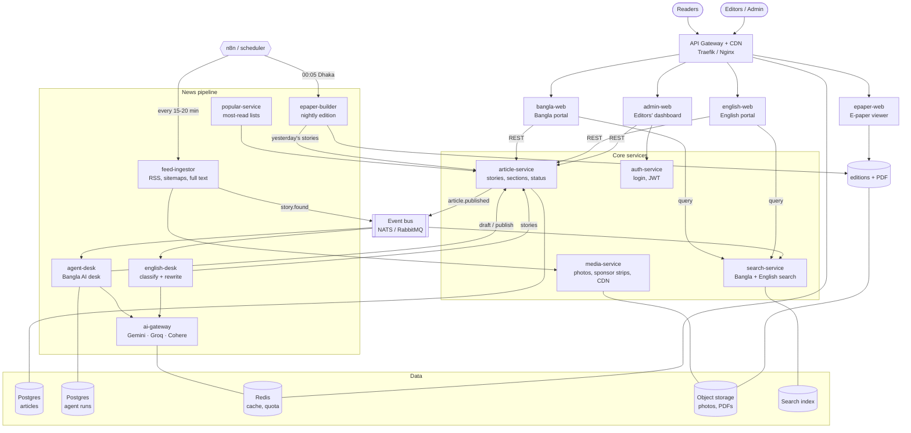
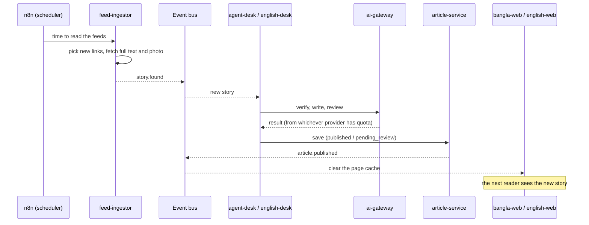

# Microservice architecture (proposal)

Today the whole system runs as one Go server (a modular monolith): the Bangla
portal, the English portal, the e-paper, the admin panel, images and the AI
desk's endpoints, with one Postgres database and n8n as the scheduler. This
document proposes how to split it into services, which part of today's code
each service would come from, the order to do it in, and what it costs to run.

## 1. The whole picture

Thin arrows are API calls; `story.found` and `article.published` are events on
the bus (nobody waits for them); each data store belongs to one service.

## 2. How one story moves

## 3. Services and where today's code goes

| Service | Kind | Job | Today's code | Data |
|---|---|---|---|---|
| api-gateway | infra | route requests, SSL, rate limits, page cache | none (Render does it) | Redis |
| bangla-web | web | Daily Star Bangla pages | `internal/handler` (public), `web/templates/public` | reads article-service |
| english-web | web | English portal | `internal/english/site.go`, `web/en` | reads article-service |
| epaper-web | web | e-paper viewer | `en_epaper.html`, `epaper.js` | editions |
| admin-web | web | editors' dashboard, approvals, journey | `internal/handler` (admin) | article-service, auth |
| auth-service | core | admin login, JWT, later SSO | `internal/usecase` (auth) | admin_users |
| article-service | core | stories, status, sections, versions, most-read | `internal/repository`, `internal/usecase` | Postgres: articles, en_articles |
| search-service | core | Bangla and English search | today a database LIKE | Meilisearch or OpenSearch |
| media-service | core | download photos, cut sponsor strips, CDN | `internal/imagestore` | object storage (R2/S3) |
| feed-ingestor | worker | read the feeds, drop duplicates, fetch full text | `internal/rss`, `internal/cron/external.go` | seen_urls |
| agent-desk | worker | Bangla AI desk: plan → verify → write → review → decide | `internal/agentic` | Postgres: agent_runs, agent_steps |
| english-desk | worker | classify and rewrite English stories | `internal/english/ingest.go` | writes to article-service |
| ai-gateway | worker | choose Gemini/Groq/Cohere, quota and cooldowns | `internal/ai/gateway.go` | Redis (quota), ai_usage |
| popular-service | worker | outlets' most-read lists | `internal/cron/popular.go` | popular_stories |
| epaper-builder | job | lay out the edition after midnight, make the PDF | `internal/english/epaper.go` | editions, object storage |
| scheduler | infra | when each job runs | n8n (as today) | n8n's own database |

## 4. Order of the split

Keep the current server running and move one part out at a time.

1. **Easy parts:** ai-gateway; media-service with object storage. Both are separate packages today.
2. **Pipeline:** add the event bus; run feed-ingestor, agent-desk and english-desk as workers; give article-service an API.
3. **Web:** bangla-web, english-web and admin-web read from article-service, with a Redis cache.
4. **The rest:** epaper-builder and epaper-web; search-service; auth-service; the gateway and monitoring.

Before step 2, the English module should get the same handler → usecase →
repository layers as the Bangla code; today its handlers query the database
directly.

## 5. Running it

- **One repository, many services:** `services/<name>/`, shared code in `pkg/`.
- **Jenkins:** one pipeline per service; only the changed folders are tested and
  built; images go to a registry (for example GHCR) and are deployed from there.
- **Monitoring:** `/health` on every service, Prometheus and Grafana for metrics,
  Loki for logs, OpenTelemetry to follow a story across services.
- **Secrets:** each service gets only the keys it needs.

## 6. Cost and recommendation

Render's free plan cannot run this: it allows 750 instance hours a month for the
whole workspace, and one service running all month uses about 720.

- **One VPS (4 GB RAM):** about $6-12 a month; all services under Docker Compose,
  later k3s. The most realistic start.
- **Render paid plans:** about $7 per service a month, over $80 in total.
- **Managed Kubernetes:** the most flexible, and the most expensive and complex.

For a team of one or two, sixteen services at once is too much to operate.
Recommended first step: split out only four parts (ai-gateway, the news pipeline
workers, media-service, epaper-builder) and keep the web pages with
article-service for now. Split the rest along the same lines when the team or
the traffic grows.
